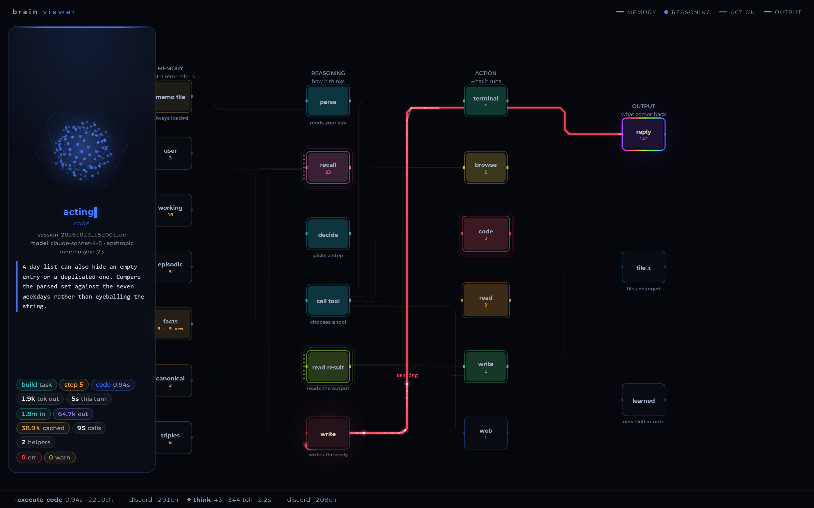

# brain viewer

A read-only window into a running Hermes Agent: what it is thinking right now, which tool it
just ran, what came back, where the answer went — drawn as a network instead of a log.

It is not a dashboard. Nothing here asks the agent to report in. The viewer reads the same files
Hermes already writes (its session database and its log) and draws them.



## Why it looks different for everyone

Nobody's Hermes is the same shape. One install is a Discord assistant with a printer attached;
another is a coding agent driven from a shell; another has five MCP servers and no memory
provider at all. A fixed diagram would show most people a picture of somebody else's agent.

So the graph is **measured, not configured**. On every load, `scan.py` reads the installation and
decides:

- **which memory tiers exist** — the memo file, the user file, and only those Mnemosyne tables
  that actually contain rows;
- **which action nodes exist** — real tool usage, grouped by kind (`terminal`, `read`, `write`,
  `browse`, `code`, `delegate`, one node per MCP server, …), ordered by how often each ran, with
  the busiest two drawn larger;
- **one colour per node**, taken from that order, so the card, the wire and the moving packet all
  agree with each other.

The reasoning column is the one thing that is fixed: `parse → recall → decide → call tool → read
result → write` is Hermes' loop, not a preference.

```
python scan.py                 # what the viewer thinks your install is
```

## Run it

No dependencies. Python 3.10+, standard library only.

```bash
git clone https://github.com/<you>/hermes-brain-viewer.git
cd hermes-brain-viewer

python app.py --demo           # a fake install is bundled: nothing to configure
# → http://127.0.0.1:8317
```

Point it at a real installation:

```bash
python app.py                  # reads $HERMES_HOME (default ~/.hermes)
python app.py --home /path/to/hermes --port 8317
```

Then open it on your phone — the layout is built for a phone first. If you reach it over
Tailscale or a tunnel, bind wide:

```bash
python app.py --host 0.0.0.0
```

### Flags

| flag | meaning |
|---|---|
| `--demo` | use the bundled fake install in `demo/`, with a scripted turn playing on a loop |
| `--home PATH` | the Hermes home to read (default `$HERMES_HOME` or `~/.hermes`) |
| `--port N` | default `8317` |
| `--host ADDR` | default `127.0.0.1`; use `0.0.0.0` only behind a private network |

`?diag=1` overlays a measurement panel — viewport, safe-area inset, ticker and card rects. It is
there because mobile layout bugs are otherwise undebuggable from a desktop.

## What it reads

| path | why |
|---|---|
| `state.db` | sessions, messages, tool results, token usage, delegations — opened `mode=ro` |
| `mnemosyne/data/mnemosyne.db` | memory tiers: working, episodic, facts, canonical, triples |
| `logs/agent.log` | the live stream: API calls, tool completions, streamed batches, deliveries |
| `MEMORY.md`, `USER.md` | the two files Hermes keeps in every prompt |
| `skills/` | how many playbooks exist, which were loaded recently |

Everything is read-only except `mnemosyne/` writes, which this tool never performs. The Discord
channel-name lookup is **off by default** because it needs your bot token; enable it with
`BRAIN_VIEWER_DISCORD=1` if you want names instead of chat ids.

## Making your own install

`scan.py` is deliberately small and readable: the rules that turn a tool name into a node are one
list at the top of the file (`RULES`), and the palette is one list below it. If your setup groups
work differently — say you want every MCP server separate, or your `execute_code` deserves its own
colour — edit those two lists and reload. There is nothing to migrate.

## The demo

`--demo` serves `demo/state.db` and `demo/mnemosyne.db` (a synthetic install, generated by
`demo/build_demo.py`) and starts `demo/live.py`, which writes a believable turn into
`demo/agent.log` on a loop: six API calls, five tool calls, three streamed batches, a delivery,
then a rest. Every other part of the app cannot tell it from a real Hermes.

```bash
python demo/build_demo.py      # regenerate the fixtures
```

## Keyboard

- `Ctrl/Cmd + Shift + C` — play several tasks at once, at the pace a real session moves
- `D` — replay the walkthrough
- click a node — its caption and current value

## Limits

- Reads one Hermes home at a time; there is no multi-profile switcher.
- The live column tails a log, so it shows what is happening, not what could happen.
- It never writes to Hermes: no prompts, no tool calls, no memory edits. If you want to act on
  what you see, that is a different tool.

## License

MIT. See [LICENSE](LICENSE).
